  

[About](#about-me) &nbsp;·&nbsp; [Stack](#tech-stack--technology-constellation) &nbsp;·&nbsp; [Projects](#featured-projects--mission-archives) &nbsp;·&nbsp; [Telemetry](#github-telemetry--statistics) &nbsp;·&nbsp; [Journey](#current-orbit--learning-journey) &nbsp;·&nbsp; [Connect](#establish-connection--lets-connect)

## About Me

I'm a final-year **D4 Informatics Engineering** student at **Universitas Airlangga**, based in Indonesia. I build software from the data layer up to the pixels — Laravel services, relational schemas, Flutter apps, and the interfaces that tie them together.

Most of my attention right now goes to my thesis: a **hypertension risk prediction system** that uses wrapper-based feature selection (Sequential Forward Selection) to trim the input set, K-Nearest Neighbors to classify risk, and **SHAP** to explain why the model predicts what it predicts. It sits at the intersection of what I enjoy most — machine learning, explainable AI, and building tools people can actually read and use.

Outside of that, I work on web and mobile projects, sketch interface concepts in Figma, and keep a running list of small side projects that solve very specific problems.

- **Education** — D4 Teknik Informatika, Universitas Airlangga
- **Based in** — Indonesia
- **Focus** — Software engineering, web & mobile development, machine learning, explainable AI, UI/UX
- **Currently** — Finishing my thesis on explainable hypertension risk prediction
- **Open to** — Internship and junior developer opportunities in IT

 

<b>Bahasa Indonesia</b>

 

Saya mahasiswa D4 Teknik Informatika Universitas Airlangga dan berdomisili di Indonesia. Saya terbiasa mengerjakan perangkat lunak dari lapisan data hingga antarmuka — layanan Laravel, skema basis data relasional, aplikasi Flutter, serta desain antarmuka yang menyertainya.

Saat ini fokus utama saya adalah skripsi: **sistem prediksi risiko hipertensi** yang memakai *wrapper-based feature selection* (Sequential Forward Selection) untuk memilih fitur, K-Nearest Neighbors untuk klasifikasi risiko, dan **SHAP** untuk menjelaskan alasan di balik prediksi model. Di luar itu, saya mengerjakan proyek web dan mobile, merancang konsep UI di Figma, dan terus menambah proyek sampingan yang menyelesaikan masalah kecil secara spesifik.

Minat utama saya mencakup software engineering, web dan mobile development, machine learning, explainable AI, data science, serta UI/UX design. Saya sedang membuka kesempatan magang dan posisi junior di bidang IT.

## Tech Stack & Technology Constellation

The tools I reach for most, grouped by where they sit in a project. No invented proficiency levels — just the stack I actually work with.

**Languages** 

**Web & App Frameworks** 

**Data & Backend** 

**Workflow & Design** 
 

## Featured Projects / Mission Archives

<table>
  <tr>
    <td width="50%" valign="top">
      <h3>Hypertension Risk Prediction System</h3>
      
Machine learning · Thesis research

      
Predicts hypertension risk from clinical data and explains every prediction. Wrapper-based feature selection narrows the input set before KNN classifies risk, and SHAP values translate the model's behavior into readable, per-patient explanations.

      
<b>Stack</b> 
      <code>Python</code> <code>scikit-learn</code> <code>Pandas</code> <code>SHAP</code>

      
<b>Highlights</b> 
      Sequential Forward Selection for feature reduction · KNN classification · SHAP-based explanations · experimental evaluation for the thesis

      

    </td>
    <td width="50%" valign="top">
      <h3>ChipIn</h3>
      
Mobile app · Bill splitting

      
A bill-splitting app for group meals. It scans the receipt with OCR, assigns items to the right people, adds tax and service charge correctly, and exports the final split as PDF or Excel.

      
<b>Stack</b> 
      <code>Flutter</code> <code>Dart</code> <code>OCR</code> <code>PDF/Excel export</code>

      
<b>Highlights</b> 
      Receipt text extraction · per-item participant assignment · tax and service charge calculation · shareable PDF/Excel summaries

      

    </td>
  </tr>
  <tr>
    <td width="50%" valign="top">
      <h3>GrowFarm</h3>
      
Web platform · Agriculture information

      
An agriculture information platform built with Laravel. It organizes farming guides and crop information, with an admin workflow so the content stays structured and current instead of scattered across documents.

      
<b>Stack</b> 
      <code>Laravel</code> <code>PHP</code> <code>MySQL</code> <code>Bootstrap</code>

      
<b>Highlights</b> 
      Structured farming content · admin content management · responsive reading experience

      

    </td>
    <td width="50%" valign="top">
      <h3>ClassCheck</h3>
      
Web system · Attendance management

      
An attendance management system for university classes — session records, student presence, and recaps that are easier to audit than a paper sign-in sheet.

      
<b>Focus</b> 
      Attendance sessions · student presence tracking · class-level reporting

      
<b>Highlights</b> 
      Replaces manual sign-in · clear per-class attendance records · straightforward recap for lecturers

      

    </td>
  </tr>
  <tr>
    <td width="50%" valign="top">
      <h3>Room Management System</h3>
      
Web system · Room booking

      
Room booking and management built with Laravel and MySQL, containerized with Docker so the whole stack can be brought up consistently on any machine.

      
<b>Stack</b> 
      <code>Laravel</code> <code>MySQL</code> <code>Docker</code>

      
<b>Highlights</b> 
      Room scheduling and records · containerized development environment · consistent setup across machines

      

      
Repository available on request.

    </td>
    <td width="50%" valign="top">
      <h3>More on GitHub</h3>
      
Experiments · coursework · works in progress

      
Smaller builds, class assignments, and whatever I'm currently breaking live in my repositories. Some project sources are private while the work is still in progress.

      

    </td>
  </tr>
</table>

## GitHub Telemetry & Statistics

Live data pulled from my GitHub account — nothing hardcoded.

 

 

 

Live cards and graphs, plus a snake rebuilt every 12 hours by GitHub Actions.

## Current Orbit / Learning Journey

- **Software engineering** — sharpening architecture and code quality across Laravel and Flutter projects, with Docker in the mix.
- **Machine learning & explainable AI** — finishing the hypertension model, studying feature selection strategies, and reading SHAP outputs critically instead of taking them at face value.
- **Mobile development** — Flutter for cross-platform apps, from OCR-driven workflows to fast, simple interfaces.
- **UI/UX design** — turning Figma explorations into interfaces that stay readable when real data arrives.
- **Thesis** — writing up methodology, experiments, and evaluation for the hypertension risk prediction system.
- **Next stop** — an internship or junior role where I can contribute to production software and learn from a real engineering team.

## Establish Connection / Let's Connect

Open to internship and junior developer opportunities, project collaborations, or a conversation about machine learning, Laravel, or interface design. These go straight to my profiles.

<!--
  Email CTA — uncomment once the address is ready:
  
-->

